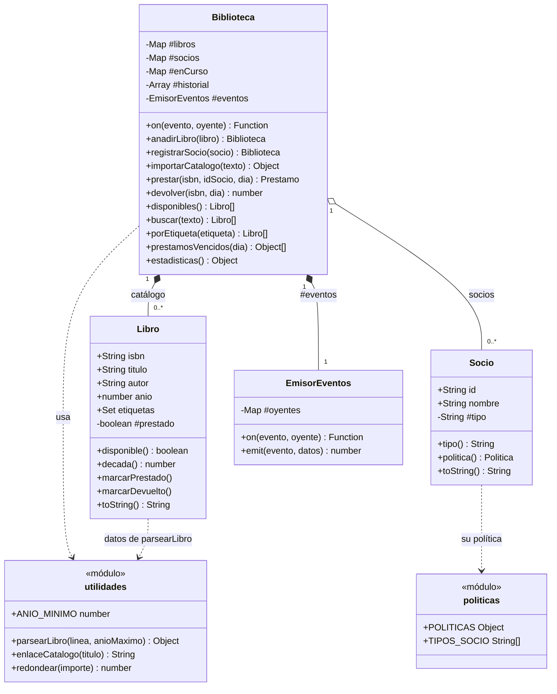
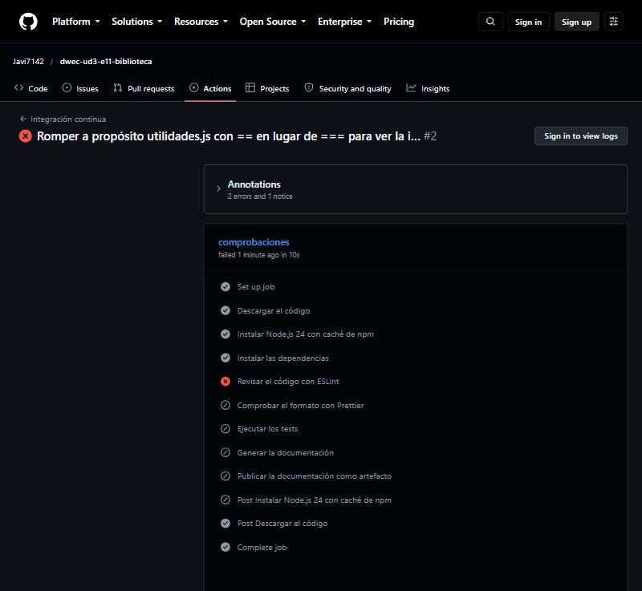

# Biblioteca

Librería de JavaScript para gestionar una biblioteca: catálogo, socios y préstamos, con funciones predefinidas, colecciones, operaciones agregadas, clases, módulos y patrones de diseño (Observer y Strategy), con tests propios y documentación generada con JSDoc.

Repositorio del ejercicio: <https://github.com/Javi7142/dwec-ud3-e11-biblioteca>

## Cómo ejecutarlo

Desde la carpeta del proyecto, en el Dev Container (o en un equipo con Node.js 24):

```bash
npm install            # instala las dependencias (el contenedor ya lo hace al crearse)
npm start              # programa de demostración (src/main.js)
npm test               # tests con Vitest
npm run lint           # ESLint
npm run format:check   # comprueba el formato con Prettier (npm run format lo corrige)
npm run docs           # genera la documentación con JSDoc en docs/
node scripts/depurar.js  # sesión de depuración reproducible (ver «Depuración»)
```

La documentación se genera en la carpeta `docs/`; se abre con el navegador en `docs/index.html` (su portada es este mismo README).

Salida de `npm start`:

```text
📚 Catálogo: 7 libros importados · 3 líneas descartadas
👥 Tipos de socio: general, estudiante, profesorado
🔄 Operaciones:
  📗 Ana se lleva «Cien años de soledad» (Gabriel García Márquez, 1967) hasta el día 22
  📗 Ana se lleva «El hobbit» (J. R. R. Tolkien, 1937) hasta el día 23
  📗 Luis se lleva «Patria» (Fernando Aramburu, 2016) hasta el día 17
  📗 Luis se lleva «Rayuela» (Julio Cortázar, 1963) hasta el día 17
  ❌ Luis ha alcanzado su máximo de 2 préstamos
  ❌ «Cien años de soledad» ya está prestado
  ❌ No existe el libro 0000000000000
  ❌ No existe el socio S9
  📘 Luis devuelve «Patria» con 3 días de retraso · multa 1.50 €
  📘 Ana devuelve «Cien años de soledad» con 18 días de retraso · multa 3.60 €
  📗 Luis se lleva «Harry Potter y la piedra filosofal» (J. K. Rowling, 1997) hasta el día 35
  📗 Marta se lleva «Eloquent JavaScript» (Marijn Haverbeke, 2018) hasta el día 51
  📘 Ana devuelve «El hobbit» con 37 días de retraso · multa 5.00 €
  📘 Luis devuelve «Rayuela» a tiempo
  ❌ «Patria» no está prestado
✅ Disponibles: Cien años de soledad, El hobbit, La sombra del viento, Patria, Rayuela
🔎 Buscar «ZAF»: La sombra del viento · «tolkien»: El hobbit
🏷️ Clásicos: Cien años de soledad, El hobbit, Rayuela
⏰ Vencidos el día 50: Harry Potter y la piedra filosofal (Luis, 15 días)
📊 7 libros · 2 prestados · 3 socios · multas: 10.10 €
📊 Por décadas: 1930: 1 · 1960: 2 · 1990: 1 · 2000: 1 · 2010: 2
📊 Socio más lector: Luis
🔗 https://catalogo.example/buscar?titulo=La%20sombra%20del%20viento
```

## Diseño

**1. Diagrama de clases.**



**2. Responsabilidad de cada módulo.**

| Módulo | Responsabilidad |
|--------|-----------------|
| `src/utilidades.js` | Funciones puras: leer una línea del catálogo (`parsearLibro`), construir el enlace de búsqueda (`enlaceCatalogo`) y redondear importes (`redondear`) |
| `src/politicas.js` | Las reglas de cada tipo de socio (máximo de préstamos, días, multa) y la lista de tipos |
| `src/Libro.js` | Un libro del catálogo y su estado de préstamo |
| `src/Socio.js` | Un socio y su tipo; entrega su política |
| `src/EmisorEventos.js` | Mecanismo de suscripción y aviso de eventos (Observer), reutilizable |
| `src/Biblioteca.js` | Coordina catálogo, socios y préstamos; valida las operaciones, calcula multas y estadísticas y emite los eventos |
| `src/index.js` | Interfaz pública de la librería (no se modifica) |
| `src/main.js` | Programa de demostración: es el único que muestra mensajes por consola (no se modifica) |

**3. Herencia y composición.** No hay herencia en el proyecto, y es una decisión deliberada: ninguna relación es de tipo «es un».
- **Composición:** `Biblioteca` **tiene** un `EmisorEventos` (campo privado `#eventos`) y le delega `on` y `emit`. Con herencia (`class Biblioteca extends EmisorEventos`) habría salido `emit` como método público de la biblioteca y cualquiera de fuera podría fingir un préstamo con `biblioteca.emit('prestamo', …)`; con composición, solo la propia biblioteca puede emitir. Además, una biblioteca no «es un» emisor de eventos: tiene uno.
- **Composición con Strategy:** `Socio` **tiene** una política (la de su tipo), en lugar de existir subclases `SocioEstudiante`, `SocioGeneral`… Así, añadir un tipo es añadir una entrada en `POLITICAS`, y el tipo no se puede confundir con la clase (el mismo objeto no puede cambiar de clase, pero sí de política).
- **Asociación:** `Biblioteca` guarda libros y socios (relación de agregación / composición del catálogo), pero un `Libro` no sabe quién lo tiene.

**4. Características de la orientación a objetos de JavaScript que uso.**

| Característica | Dónde |
|----------------|-------|
| Campos privados (`#`) | `Libro.#prestado`, `Socio.#tipo`, `Biblioteca.#libros/#socios/#enCurso/#historial/#eventos`, `EmisorEventos.#oyentes` |
| _Getters_ sin _setter_ | `Libro.disponible`, `Libro.decada`, `Socio.tipo`, `Socio.politica` (asignarlos lanza `TypeError`) |
| `toString()` | `Libro` (`«Rayuela» (Julio Cortázar, 1963)`) y `Socio` (`Luis (general)`), usados por las plantillas de texto de `main.js` |
| Métodos con validación y errores | `marcarPrestado`/`marcarDevuelto`, `prestar`, `devolver`, constructores con `RangeError` |
| Constantes de módulo congeladas | `POLITICAS` y `TIPOS_SOCIO` con `Object.freeze` |
| Encadenamiento | `anadirLibro` y `registrarSocio` devuelven `this` |
| Módulos ES | `import`/`export` en todos los ficheros y fachada pública en `index.js` |

## Colecciones

| Dato | Colección | Por qué |
|------|-----------|---------|
| Catálogo de libros | `Map` ISBN → `Libro` | Los préstamos buscan siempre por ISBN: `get`/`has` van directos, sin recorrer; la clave es única (el ISBN repetido se detecta con `has`) y conserva el orden de alta, que es el que piden `buscar` y `porEtiqueta` |
| Socios | `Map` id → `Socio` | Se buscan por id y el id es único |
| Préstamos en curso | `Map` ISBN → préstamo | Un libro solo puede estar prestado una vez; devolver es `get` + `delete` |
| Historial de préstamos | Array | Es una secuencia en orden cronológico, con repetidos (un libro se presta muchas veces); se recorre entero para las estadísticas (`reduce`) |
| Etiquetas de un libro | `Set` | No tiene sentido repetir una etiqueta y `has` es la consulta habitual (`porEtiqueta`) |
| Libros por década | `Map` década → nº | Claves numéricas que se mantienen como números (en un objeto serían texto) y orden de inserción garantizado (se ordena por década) |
| `POLITICAS` | Objeto congelado | Es una tabla fija de configuración con claves conocidas (`general`…) |

**Cómo evito devolver las colecciones privadas.** Ningún método devuelve un `Map` ni el historial: las consultas (`disponibles`, `buscar`, `porEtiqueta`, `prestamosVencidos`) construyen un **array nuevo** con `[...mapa.values()]` y `filter`/`map`/`toSorted`; `estadisticas()` crea un objeto y un `Map` nuevos. La copia es **superficial**: el array es nuevo (modificarlo, vaciarlo o ordenarlo no afecta a la biblioteca; hay un test que lo comprueba), pero contiene los mismos objetos `Libro`/`Socio`. No es un riesgo para el estado de préstamo, porque el estado vive en el campo privado `#prestado` del libro, que solo se cambia con `marcarPrestado`/`marcarDevuelto`, y la biblioteca es la única que los llama en su flujo.

## Patrones

**1. Observer (`EmisorEventos` → `Biblioteca` → funciones de `main.js`).**
- **Problema que resuelve aquí:** cuando se hace un préstamo o una devolución, otras partes del programa quieren enterarse (mostrar un mensaje, avisar al socio…), pero `Biblioteca` no debe mostrar nada por consola ni conocer a quien le escucha. Sin el patrón, `prestar` tendría un `console.log` o llamadas a un módulo de avisos, y cada aviso nuevo obligaría a editar `Biblioteca.js`.
- **Piezas:** el **sujeto** es `Biblioteca` (emite `prestamo` y `devolucion` mediante su `EmisorEventos` interno); el **mecanismo** es `EmisorEventos` (`on` suscribe y devuelve la función de baja, `emit` avisa en orden); los **observadores** son las funciones que `main.js` pasa a `biblioteca.on(...)`.
- **Cómo se nota en el código:** en `Biblioteca.js` no hay ningún `console`; solo `this.#eventos.emit('prestamo', {...})` **después** de que la operación haya tenido éxito, así que una operación que falla no emite nada (lo comprueban los tests).

**2. Strategy (`POLITICAS` en `politicas.js`).**
- **Problema que resuelve aquí:** las reglas de cada tipo de socio (máximo de préstamos, días y multa) son distintas, y la biblioteca no debe tener `if (socio.tipo === 'estudiante') …` para calcularlas. Cada tipo de socio es una **estrategia**: un objeto con la misma interfaz (`maxPrestamos`, `diasPrestamo`, `multa(diasRetraso)`).
- **Piezas:** las **estrategias** son las entradas de `POLITICAS` (`general`, `estudiante`, `profesorado`); el **contexto** es `Biblioteca`, que en `prestar` y `devolver` solo hace `socio.politica…`; el **selector** es `Socio`, que entrega la política de su tipo.
- **Cómo se nota en el código:** `Biblioteca.js` nunca menciona `'general'`, `'estudiante'` ni `'profesorado'`: añadir un tipo de socio no toca la biblioteca.

**3. Módulo.** Cada fichero es un módulo ES con su propio ámbito, y `index.js` es la fachada pública (patrón Módulo): oculta qué fichero define qué, y los tests de integración usan la librería solo a través de ella.

## Funciones predefinidas

| Función | Familia | Dónde | Para qué |
|---------|---------|-------|----------|
| `Number` | Global de conversión | `parsearLibro` | Convertir el año. Convierte el texto **entero**: `'1967b'` da `NaN` (se rechaza) y `''` da 0 (queda fuera de rango). `parseInt('1967b')` daría 1967 y aceptaría un año mal escrito |
| `Number.isInteger` | Método estático de `Number` | `parsearLibro` | Validar que el año es un entero (no `NaN`, ni `1967.5`) sin convertir nada |
| `encodeURIComponent` | Global de URI | `enlaceCatalogo` | Codificar el título para que vaya dentro de un parámetro de la URL (escapa `&`, `=`, espacios y tildes; `encodeURI` no escapa `&`) |
| `Math.round` | Método estático de `Math` | `redondear` | Redondear importes a céntimos |
| `Math.max` | Método estático de `Math` | `devolver` | Días de retraso: nunca negativos (`Math.max(0, dia - diaLimite)`) |
| `Math.min` | Método estático de `Math` | `POLITICAS.estudiante.multa` | Limitar la multa al máximo de 5 € |
| `Math.floor` | Método estático de `Math` | `Libro.decada` | Calcular la década (1967 → 1960) |
| `Object.groupBy` | Método estático de `Object` | `estadisticas` | Agrupar los libros por década |
| `Object.entries` | Método estático de `Object` | `estadisticas` | Pasar los grupos a pares `[década, grupo]` |
| `Object.keys` | Método estático de `Object` | `TIPOS_SOCIO` | Sacar los tipos de socio de `POLITICAS` (sin repetir la lista) |
| `Object.freeze` | Método estático de `Object` | `politicas.js` | Evitar que se modifiquen las políticas |
| `String.prototype.localeCompare` | Método de `String` | `disponibles` | Ordenar títulos con las reglas del español |
| `Array.prototype.toSorted` | Método de `Array` | `disponibles`, `prestamosVencidos`, `estadisticas` | Ordenar sin modificar el array |

## Operaciones agregadas

| Método | Operaciones | Tipo |
|--------|-------------|------|
| `importarCatalogo` | `split`, `map`, `filter`, `findIndex` (dentro de `filter` para quedarse con la primera aparición de cada ISBN) y `forEach` para guardar | Transformación y filtrado |
| `prestar` | `filter` sobre `[...#enCurso.values()]` para contar los préstamos del socio | Filtrado |
| `disponibles` | `filter` + `toSorted` con `localeCompare` | Filtrado y ordenación |
| `buscar` | `filter` con `includes` sobre título y autor en minúsculas | Filtrado |
| `porEtiqueta` | `filter` con `Set.has` | Filtrado |
| `prestamosVencidos` | `filter` + `map` + `toSorted` | Filtrado, transformación y ordenación |
| `estadisticas` (libros por década) | `Object.groupBy`, `Object.entries`, `map`, `toSorted` | Recolección |
| `estadisticas` (socio más lector) | `reduce` (cuenta de préstamos por socio en un `Map`) y otro `reduce` para quedarse con el máximo | Reducción |
| `estadisticas` (multas totales) | `reduce` sobre el historial | Reducción |

Los _callbacks_ de `map`, `filter` y `reduce` son puros: no modifican nada fuera de ellos (los `Map` de los `reduce` son acumuladores creados dentro de la operación).

## Depuración

Sesión real con el depurador de Node.js. No he usado el panel de VS Code, que no está disponible en mi entorno de trabajo, sino el mismo depurador (el protocolo del inspector de V8 con el que se conectan VS Code y Chrome DevTools) manejado con un pequeño script, [`scripts/depurar.js`](scripts/depurar.js), que lanza `node --inspect-brk src/main.js`, pone el punto de ruptura y muestra lo que mostrarían los paneles de VS Code. Se ejecuta con `node scripts/depurar.js`.

**1. Qué quería entender.** En la salida de `npm start`, Ana devuelve «El hobbit» con 37 días de retraso y paga 5.00 €, no 7.40 € (37 × 0,20 €). Quería ver el cálculo de la multa y confirmar que el tope del estudiante se aplica ahí.

**2. Punto de ruptura.** En `src/Biblioteca.js`, línea 224, la que calcula `const multa = redondear(prestamo.socio.politica.multa(diasRetraso))` dentro de `devolver`. Es **condicional**: `isbn === '9788445077528'` (el de «El hobbit»), porque `devolver` se ejecuta cinco veces y solo me interesaba esa. Sin condición habría parado también con las demás devoluciones y con el error de `«Patria» no está prestado`. El script ignora la primera pausa (la de `--inspect-brk`, al arrancar) y se detiene en la mía.

**3. Pila de llamadas.** Salida del script:

```text
⏸️  Pausa en src/Biblioteca.js:224 con la condición isbn === '9788445077528'

📚 Pila de llamadas:
  0. devolver  src/Biblioteca.js:224
  1. (anónima)  src/main.js:61
  2. (anónima)  src/main.js:69
  3. run  esm/module_job:561

🔭 Ámbito del marco superior:
  ▸ local (devolver)
      isbn: 9788445077528
      dia: 60
      libro: Libro
      prestamo: Object
      diasRetraso: 37
  ▸ module
      EmisorEventos: class EmisorEventos {
      Libro: class Libro {
      parsearLibro: function parsearLibro(linea, anioMaximo = 2100) {
      redondear: function redondear(importe) {
      Biblioteca: class Biblioteca {
  ▸ this
      #libros (privado): Map(7)
      #socios (privado): Map(3)
      #enCurso (privado): Map(4)
      #historial (privado): Array(6)
      #eventos (privado): EmisorEventos

🧪 Expresiones evaluadas en este marco:
  dia - prestamo.diaLimite → 37
  diasRetraso → 37
  prestamo.socio.politica.multa(diasRetraso) → 5
  multa → ReferenceError: Cannot access 'multa' from debugger
```

Los marcos son `devolver` (línea 223), dos funciones anónimas de `main.js` (la de la lista `operaciones` en la línea 61, que llama a `biblioteca.devolver`, y el bucle `for…of` de la línea 69 que ejecuta cada operación) y el cargador de módulos (`run`). Revisé el marco 0, para ver los valores, y el 1, para confirmar que la llamada es `biblioteca.devolver(ISBN.hobbit, 60)`.

**4. Panel «Ámbito».**
- **Local (`devolver`):** `isbn` = `9788445077528`, `dia` = 60, `libro` = el `Libro` de «El hobbit», `prestamo` = el objeto `{ libro, socio, diaLimite }` y `diasRetraso` = **37**. Con el día límite 23 (día 2 más 21 días de un estudiante) y el día 60, salen 37 días de retraso: el dato de entrada es correcto.
- **Módulo (closure del fichero):** las clases `EmisorEventos`, `Libro`, `Biblioteca` y las funciones `parsearLibro` y `redondear` importadas.
- **`this`:** la biblioteca, con sus **campos privados** visibles aunque desde fuera no se pueden leer: `#libros` (Map de 7), `#socios` (3), `#enCurso` (4 préstamos en este momento, antes de borrar el de «El hobbit»), `#historial` (6 préstamos hechos hasta ese momento) y `#eventos`.
- **Evaluación de expresiones en el marco:** `dia - prestamo.diaLimite` → 37 y `prestamo.socio.politica.multa(diasRetraso)` → **5**: la política de estudiante da 5, no 7.4. Y `multa` → `ReferenceError: Cannot access 'multa' from debugger`: es normal, el depurador está **antes** de ejecutar la línea, y las variables `const` no se pueden leer hasta que se declaran («zona muerta temporal»); no es un fallo del programa.

**5. Conclusión.** La multa de 5.00 € es correcta: la función `multa` del estudiante, `Math.min(diasRetraso * 0.2, 5)`, devuelve 5 con 37 días porque 37 × 0,2 = 7,4 supera el tope. No cambié el código. Los tests del tope ya estaban escritos (`Socio.test.js`: 25 días → justo 5 €, 26 y 1000 días → 5 €; `Biblioteca.test.js`: 25 y 100 días de retraso), y la sesión confirma que lo que prueban es lo que ocurre de verdad dentro de `devolver`.

## Pruebas

**1. Salida de `npm test`** (con `--reporter=verbose`, que muestra cada test):

```text

 RUN  v5.0.5 /w

 ✓ Libro > constructor > guarda los datos del objeto que recibe 1ms
 ✓ Libro > constructor > guarda las etiquetas como un Set, sin repetidas 1ms
 ✓ Libro > constructor > no comparte el array de etiquetas con quien lo creó 0ms
 ✓ Libro > disponible > es true en un libro recién creado 0ms
 ✓ Libro > disponible > es false mientras el libro está prestado 0ms
 ✓ Libro > disponible > no se puede asignar desde fuera 0ms
 ✓ Libro > decada > el año 1967 es de la década de 1960 0ms
 ✓ Libro > decada > el año 1960 es de la década de 1960 0ms
 ✓ Libro > decada > el año 1969 es de la década de 1960 0ms
 ✓ Libro > decada > el año 2000 es de la década de 2000 0ms
 ✓ Libro > decada > el año 1450 es de la década de 1450 0ms
 ✓ Libro > marcarPrestado y marcarDevuelto > cambian la disponibilidad en los dos sentidos 0ms
 ✓ Libro > marcarPrestado y marcarDevuelto > marcarPrestado lanza un error si ya está prestado 0ms
 ✓ Libro > marcarPrestado y marcarDevuelto > marcarDevuelto lanza un error si no está prestado 0ms
 ✓ Libro > marcarPrestado y marcarDevuelto > se puede prestar de nuevo después de devolverlo 0ms
 ✓ Libro > toString > muestra el título, el autor y el año 0ms
 ✓ parsearLibro > devuelve null con una línea sin cinco campos 1ms
 ✓ parsearLibro > lee los cinco campos de una línea correcta 0ms
 ✓ parsearLibro > quita los espacios de cada campo y pasa las etiquetas a minúsculas sin las vacías 0ms
 ✓ parsearLibro > devuelve etiquetas vacías si el campo de etiquetas está vacío 0ms
 ✓ parsearLibro > devuelve null con una línea con cuatro campos 0ms
 ✓ parsearLibro > devuelve null con una línea con seis campos 0ms
 ✓ parsearLibro > devuelve null con una línea vacía 0ms
 ✓ parsearLibro > devuelve null si el ISBN está vacío 0ms
 ✓ parsearLibro > devuelve null si el título está vacío o solo tiene espacios 0ms
 ✓ parsearLibro > límites del año > acepta el año mínimo, 1450 0ms
 ✓ parsearLibro > límites del año > rechaza el año anterior al mínimo, 1449 0ms
 ✓ parsearLibro > límites del año > acepta el año máximo por defecto, 2100, y rechaza 2101 0ms
 ✓ parsearLibro > límites del año > usa el año máximo que se le pasa: 2025 sí, 2026 no 0ms
 ✓ parsearLibro > límites del año > rechaza el año «1967b», que no es un entero válido 0ms
 ✓ parsearLibro > límites del año > rechaza el año «abcd», que no es un entero válido 0ms
 ✓ parsearLibro > límites del año > rechaza el año «19.5», que no es un entero válido 0ms
 ✓ parsearLibro > límites del año > rechaza el año «», que no es un entero válido 0ms
 ✓ parsearLibro > límites del año > rechaza el año « », que no es un entero válido 0ms
 ✓ parsearLibro > límites del año > rechaza el año «1e3», que no es un entero válido 0ms
 ✓ parsearLibro > límites del año > rechaza el año «-1967», que no es un entero válido 0ms
 ✓ enlaceCatalogo > codifica el título para que pueda ir en la URL 0ms
 ✓ enlaceCatalogo > codifica el & y las tildes (con encodeURI el & rompería el parámetro) 0ms
 ✓ enlaceCatalogo > con un título vacío deja el parámetro vacío 0ms
 ✓ redondear > redondea a céntimos un error de coma flotante 0ms
 ✓ redondear > deja igual un importe que ya tiene dos decimales 0ms
 ✓ redondear > devuelve 0 con 0 0ms
 ✓ TIPOS_SOCIO > lista los tres tipos de socio 1ms
 ✓ POLITICAS > el tipo general permite 2 préstamos durante 14 días 0ms
 ✓ POLITICAS > el tipo estudiante permite 3 préstamos durante 21 días 0ms
 ✓ POLITICAS > el tipo profesorado permite 5 préstamos durante 30 días 0ms
 ✓ POLITICAS > multa del socio general: 0,50 € por día > es 0 sin retraso 0ms
 ✓ POLITICAS > multa del socio general: 0,50 € por día > es 1,50 € con tres días de retraso 0ms
 ✓ POLITICAS > multa del socio general: 0,50 € por día > no tiene tope 0ms
 ✓ POLITICAS > multa del estudiante: 0,20 € por día con tope de 5 € > es 0 sin retraso 0ms
 ✓ POLITICAS > multa del estudiante: 0,20 € por día con tope de 5 € > es 1 € con cinco días de retraso 0ms
 ✓ POLITICAS > multa del estudiante: 0,20 € por día con tope de 5 € > llega justo al tope con 25 días (5 €) 0ms
 ✓ POLITICAS > multa del estudiante: 0,20 € por día con tope de 5 € > no pasa del tope de 5 € con 26 días ni con 1000 0ms
 ✓ POLITICAS > multa del profesorado: ninguna > es siempre 0, también con mucho retraso 0ms
 ✓ POLITICAS > las políticas no se pueden modificar (están congeladas) 0ms
 ✓ Socio > guarda el id, el nombre y el tipo 0ms
 ✓ Socio > es de tipo general si no se indica el tipo 0ms
 ✓ Socio > lanza un RangeError con un tipo que no existe 1ms
 ✓ Socio > rechaza el tipo «constructor», que no está en TIPOS_SOCIO 0ms
 ✓ Socio > rechaza el tipo «», que no está en TIPOS_SOCIO 0ms
 ✓ Socio > rechaza el tipo «toString», que no está en TIPOS_SOCIO 0ms
 ✓ Socio > su política es la de su tipo 0ms
 ✓ Socio > el tipo y la política no se pueden asignar desde fuera 0ms
 ✓ Socio > toString muestra el nombre y el tipo 0ms
 ✓ anadirLibro y registrarSocio > devuelven la biblioteca para poder encadenar 2ms
 ✓ anadirLibro y registrarSocio > lanzan un error con un ISBN o un id repetidos 1ms
 ✓ importarCatalogo > cuenta los libros importados y las líneas descartadas 1ms
 ✓ importarCatalogo > ignora las líneas vacías sin contarlas como descartadas 0ms
 ✓ importarCatalogo > descarta un ISBN que ya está en el catálogo 0ms
 ✓ importarCatalogo > descarta el año fuera de rango y se queda con la primera aparición de un ISBN 0ms
 ✓ prestar > calcula el día límite con los días de la política del socio 0ms
 ✓ prestar > marca el libro como no disponible 5ms
 ✓ prestar > lanza los errores en el orden del contrato 0ms
 ✓ prestar > respeta el máximo de préstamos: el general, 2; el estudiante, 3 0ms
 ✓ prestar > comprueba el máximo antes que si el libro ya está prestado 0ms
 ✓ prestar > el máximo vuelve a dejar prestar después de devolver un libro 0ms
 ✓ devolver > no cobra multa si se devuelve el día límite 0ms
 ✓ devolver > no cobra multa si se devuelve antes del día límite 0ms
 ✓ devolver > cobra 0,50 € por día de retraso al socio general 0ms
 ✓ devolver > cobra 0,20 € por día al estudiante y se queda en el tope de 5 € 0ms
 ✓ devolver > redondea la multa del estudiante a céntimos (18 × 0,2 = 3,6) 0ms
 ✓ devolver > no cobra multa al profesorado por mucho retraso que tenga 0ms
 ✓ devolver > deja el libro disponible otra vez 0ms
 ✓ devolver > lanza un error si el libro no existe o no está prestado 0ms
 ✓ eventos > prestar emite prestamo con el libro, el socio y el día límite 1ms
 ✓ eventos > devolver emite devolucion con los días de retraso y la multa 1ms
 ✓ eventos > devolver el día límite emite devolucion con 0 días de retraso y multa 0 0ms
 ✓ eventos > no emite ningún evento cuando prestar falla 0ms
 ✓ eventos > no emite ningún evento cuando devolver falla 0ms
 ✓ eventos > una función de baja deja de recibir los eventos 0ms
 ✓ eventos > lanza un TypeError si se suscribe algo que no es una función 0ms
 ✓ consultas > disponibles ordena por título con las reglas del español 0ms
 ✓ consultas > buscar encuentra por título o autor sin distinguir mayúsculas, en el orden del catálogo 0ms
 ✓ consultas > buscar sin coincidencias devuelve una lista vacía 0ms
 ✓ consultas > porEtiqueta devuelve los libros con esa etiqueta en el orden del catálogo 0ms
 ✓ consultas > prestamosVencidos lista los vencidos del más al menos retrasado 0ms
 ✓ consultas > prestamosVencidos no incluye un préstamo que vence justo ese día 0ms
 ✓ consultas > prestamosVencidos no incluye los préstamos devueltos 0ms
 ✓ consultas > las consultas devuelven arrays nuevos: modificarlos no cambia la biblioteca 0ms
 ✓ estadisticas > en una biblioteca vacía: todo a 0 y sin socio más lector 0ms
 ✓ estadisticas > cuenta libros, prestados y socios 0ms
 ✓ estadisticas > agrupa los libros por década en un Map ordenado por década 0ms
 ✓ estadisticas > el socio más lector cuenta los préstamos en curso y los devueltos 0ms
 ✓ estadisticas > con un empate gana el socio que hizo antes su primer préstamo 0ms
 ✓ estadisticas > suma las multas redondeadas a céntimos 0ms
 ✓ estadisticas > devuelve un objeto nuevo en cada llamada 1ms
 ✓ EmisorEventos > avisa a un oyente con los datos del evento 2ms
 ✓ EmisorEventos > avisa a los oyentes en el orden en que se suscribieron y devuelve cuántos son 0ms
 ✓ EmisorEventos > no repite la misma función suscrita dos veces al mismo evento 0ms
 ✓ EmisorEventos > on devuelve una función que da de baja la suscripción 0ms
 ✓ EmisorEventos > dar de baja dos veces no falla 1ms
 ✓ EmisorEventos > emitir un evento sin oyentes avisa a 0 0ms
 ✓ EmisorEventos > un oyente suscrito a un evento no recibe los de otro 0ms
 ✓ EmisorEventos > lanza un TypeError si el oyente no es una función 0ms
 ✓ EmisorEventos > un oyente puede darse de baja mientras se emite sin saltarse a los demás 0ms

 Test Files  5 passed (5)
      Tests  115 passed (115)
   Start at  19:32:09
   Duration  444ms (import 43%, transform 36%, worker 13%, tests 8%)

```

**2. Casos límite que pruebo en cada módulo.**

| Fichero | Casos límite |
|---------|--------------|
| `utilidades.test.js` (unitario) | Año justo en 1450 (válido) y 1449 (no); en 2100 (válido) y 2101 (no); con `anioMaximo` propio (2025 sí, 2026 no); `'1967b'`, `'abcd'`, `'19.5'`, vacío, `'-1967'`; líneas con 4 y 6 campos y vacía; ISBN o título vacíos; etiquetas vacías o con espacios y mayúsculas; título vacío en el enlace; `&` y tildes en el enlace; redondeo de coma flotante (`0.1 + 0.2`) |
| `Libro.test.js` (unitario) | Etiquetas repetidas (un `Set`); décadas límite (1960, 1969, 1450); prestar un libro ya prestado y devolver uno no prestado; asignar `disponible` (`TypeError`); prestar de nuevo tras devolver |
| `Socio.test.js` y `politicas` (unitario) | Los tres tipos; tipo inexistente y nombres heredados de los objetos (`constructor`, `toString`); multa del estudiante en 0, 5, **25 días (justo el tope)**, 26 y 1000 días; multa del general sin tope; profesorado siempre 0; políticas congeladas; asignar `tipo`/`politica` |
| `EmisorEventos.test.js` (unitario) | Misma función suscrita dos veces; baja dos veces; evento sin oyentes (0); oyente que no es función; oyente que se da de baja mientras se emite |
| `Biblioteca.test.js` (integración) | Devolver **el día límite** y antes (sin multa); **tope de la multa del estudiante** (25 y 100 días); **máximo de préstamos** del general y recuperarlo al devolver; orden de los errores de `prestar`; importar texto vacío, con ISBN repetido (en el catálogo y en el propio texto) y con año fuera de rango; préstamo vencido justo el día límite (no cuenta) y devuelto (no cuenta); biblioteca vacía en `estadisticas`; empate en el socio más lector; las consultas devuelven arrays nuevos; **no se emite ningún evento cuando una operación falla** |

**3. Cómo compruebo los eventos.** Con una función espía de Vitest (`vi.fn()`) suscrita con `biblioteca.on('prestamo', oyente)`: compruebo `toHaveBeenCalledTimes(1)` y el contenido de `oyente.mock.calls[0][0]` (el libro, el socio, el día límite o los días de retraso y la multa). Para los fallos, compruebo que la función **no** se ha llamado (`not.toHaveBeenCalled()`) después de una operación que lanza error, para cada una de las causas: libro inexistente, socio inexistente, libro ya prestado y máximo de préstamos alcanzado; y lo mismo con `devolver`. También compruebo que la función de baja devuelta por `on` hace que se deje de recibir el evento.

**4. Unitarios e integración (tema 10, apartado 10.5.8).** `utilidades`, `Libro`, `Socio`/`politicas` y `EmisorEventos` son **unitarios**: prueban cada pieza sola. `Biblioteca.test.js` es **de integración**: importa todo desde `src/index.js` y usa `Biblioteca`, `Libro`, `Socio`, las políticas reales, `parsearLibro` y el emisor de eventos juntos, sin sustituir ninguna pieza por un doble. Comprueba lo que los unitarios no pueden: que las piezas encajan entre sí. Por ejemplo, que el día límite sale de la política **del socio** concreto (14, 21 o 30 días), que la multa de una devolución sale de `Socio` → `POLITICAS` → `redondear`, que `importarCatalogo` crea `Libro` con las etiquetas como `Set` a partir de `parsearLibro`, y que las estadísticas suman las multas de devoluciones reales.

**5. Un test que me falló.** Escribiendo `Biblioteca.test.js`, el test `buscar encuentra por título o autor sin distinguir mayúsculas, en el orden del catálogo` falló: `AssertionError: expected [ 'Rayuela', 'Patria', …(1) ] to have a length of 4 but got 3`. Esperaba que `buscar('a')` encontrara los 4 libros de mi catálogo de prueba, y recibió 3. **El error estaba en el test, no en el código:** «El hobbit» y su autor «J. R. R. Tolkien» no contienen ninguna letra «a», así que no deben aparecer; mi suposición era la equivocada. Corregí la expectativa para que compruebe los tres títulos concretos (`['Rayuela', 'Patria', 'Zafón por dentro']`) con un comentario que explica por qué falta «El hobbit».

## Documentación

Uso estas etiquetas JSDoc:

| Etiqueta | Para qué |
|----------|----------|
| `@module` | Nombre del módulo de cada fichero (aparece como una página en la web) |
| `@typedef` | Documentar los objetos que no son clases: `DatosLibro`, `Politica`, `Prestamo`, `EventoPrestamo`, `EventoDevolucion`, `PrestamoVencido`, `Estadisticas` |
| `@callback` | El tipo de las funciones oyente (`Oyente`) |
| `@param` / `@returns` | Parámetros y valor devuelto de cada función y método público |
| `@throws` | Los errores que lanza cada operación, con su condición |
| `@fires` | Los eventos que emiten `prestar` y `devolver` |
| `@example` | Un ejemplo de uso en las clases y en las funciones públicas de `utilidades` |
| `@type` | El tipo de los _getters_ (`disponible`, `decada`, `tipo`, `politica`) y de los campos privados |
| `@import` | Importar tipos de otros módulos para la documentación, sin importarlos en tiempo de ejecución |

`npm run docs` genera en `docs/` una web con una página por módulo y clase (con su documentación de miembros, tipos y ejemplos) y como portada este README. La carpeta `docs/` no se sube al repositorio (está en `.gitignore`).

```text
> e11-biblioteca@1.0.0 docs
> jsdoc -c jsdoc.json
```

Se genera **sin errores ni avisos**.

## Herramientas

```text

> e11-biblioteca@1.0.0 lint
> eslint .


> e11-biblioteca@1.0.0 format:check
> prettier --check .

Checking formatting...
All matched files use Prettier code style!
```

## Integración continua (opcional)

El workflow está en [`.github/workflows/ci.yml`](.github/workflows/ci.yml): un único trabajo en `ubuntu-latest` con ocho pasos: «Descargar el código», «Instalar Node.js 24 con caché de npm», «Instalar las dependencias» (`npm ci`), «Revisar el código con ESLint», «Comprobar el formato con Prettier», «Ejecutar los tests», «Generar la documentación» (`npm run docs`) y «Publicar la documentación como artefacto» (`actions/upload-artifact@v7`, `name: documentacion`, `path: docs/`).

1. **Ejecución en verde:** <https://github.com/Javi7142/dwec-ud3-e11-biblioteca/actions/runs/40570064268>
2. **Captura de la ejecución en verde con sus ocho pasos:**

   

   En el resumen de la ejecución aparece, en **Artifacts**, el artefacto `documentacion` (438 KB), con la web generada por `npm run docs`:

   

3. **Ejecución en rojo provocada a propósito:** <https://github.com/Javi7142/dwec-ud3-e11-biblioteca/actions/runs/40570210426>. Escribí `==` en lugar de `===` en `src/utilidades.js` (`if (isbn == '' || titulo === '')`) y lo subí. La ejecución falló en el paso **«Revisar el código con ESLint»** (la regla `eqeqeq` de la configuración del curso), con los cuatro pasos anteriores en verde y los siguientes (Prettier, tests, documentación y artefacto) sin ejecutarse:

   

   Después deshice el cambio (`===`) y la ejecución volvió a verde: <https://github.com/Javi7142/dwec-ud3-e11-biblioteca/actions/runs/40570331526>.
